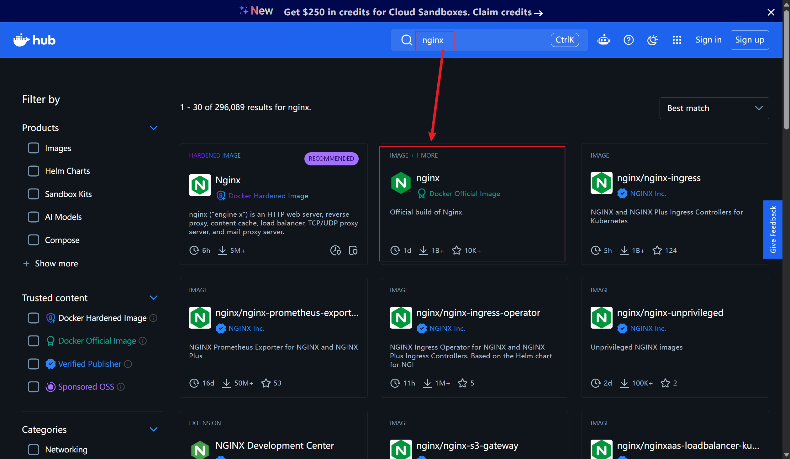
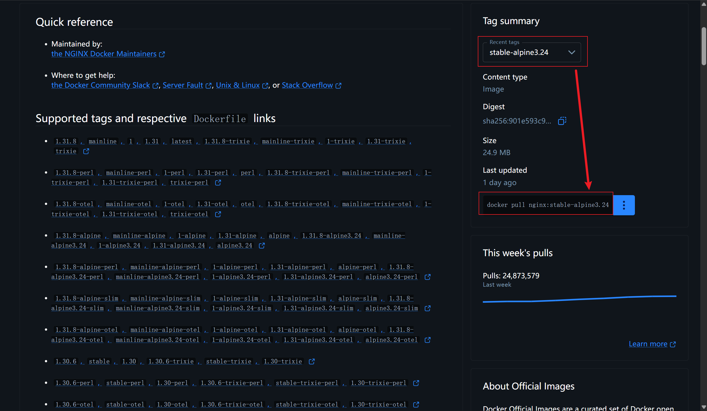
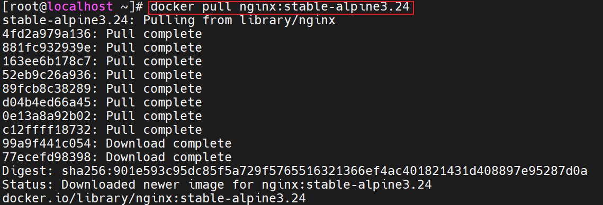
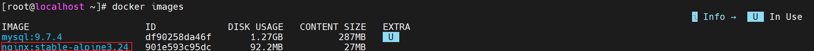
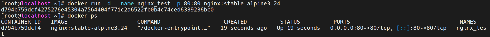
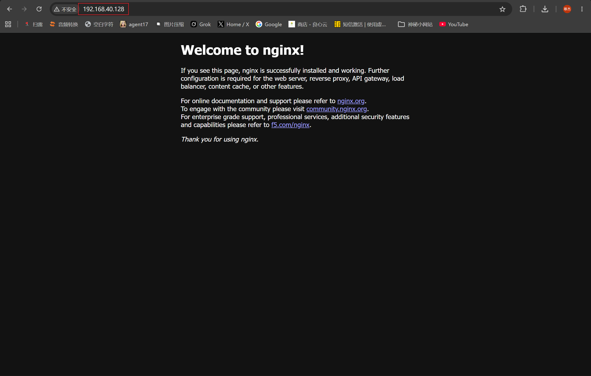
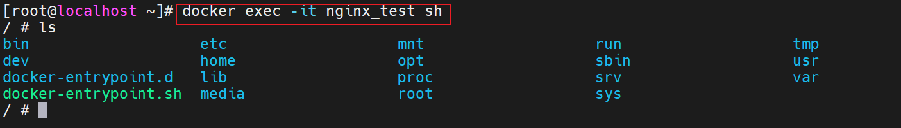
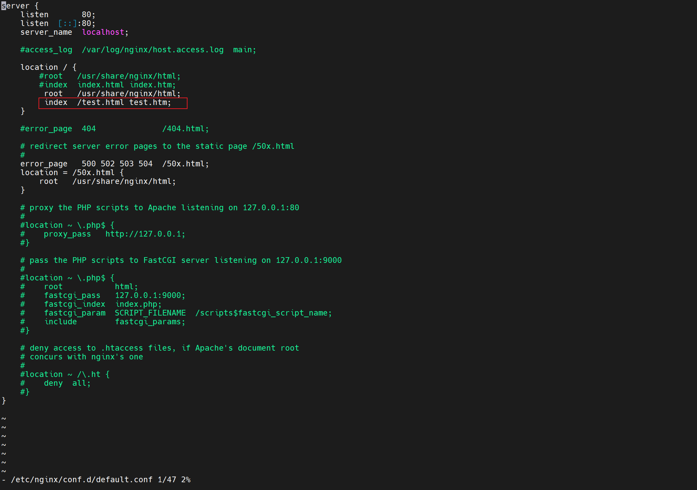
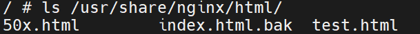
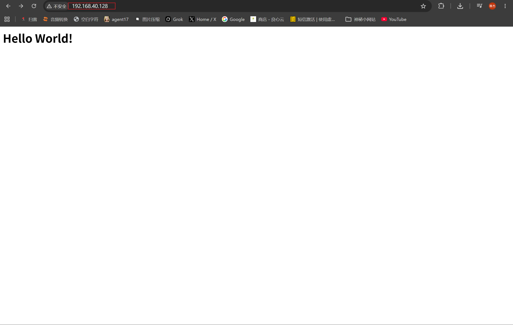

# Docker+Nginx

设备信息

CentOS Stream 10 3核4g 192.168.253.135

docker29.9.3

## 寻找镜像

打开docker hub搜索“nginx”

选择官方镜像



点进去找到版本nginx:stable-alpine3.24



## 拉取镜像

```shell
docker pull nginx:stable-alpine3.24
```



查看下载情况

```shell
docker -v
```



可见已经下载成功

## 运行容器

直接运行容器

```shell
docker run -d --name nginx_test -p 80:80 nginx:stable-alpine3.24
```



运行成功

## 验证

试试访问

浏览器访问服务器ip: http://192.168.40.128:80



很好！没有问题

## 修改配置

下面试试修改前端

先进入容器内部，由于我下的是Alpine的镜像，比较简洁，用不了bash，只能用sh

```shell
docker exec -it nginx_test sh
```



这样就进入容器内部了，让我们找找nginx的配置文件

还是位于 `/etc/nginx/conf.d/default.conf`

简单改改配置把前端文件定位到自定义的test.html



然后在/usr/share/nginx/html里加上前端文件就行了



然后重启nginx容器

```shell
docker restart nginx_test
```

再访问地址

