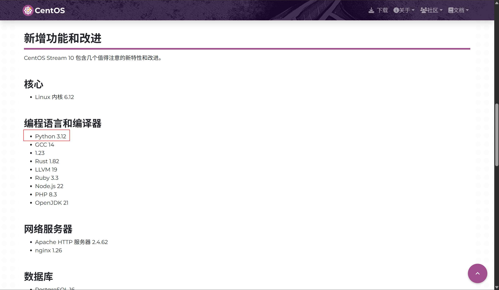
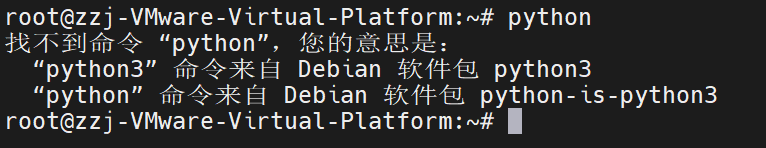
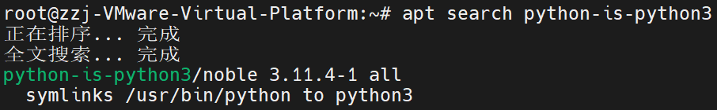
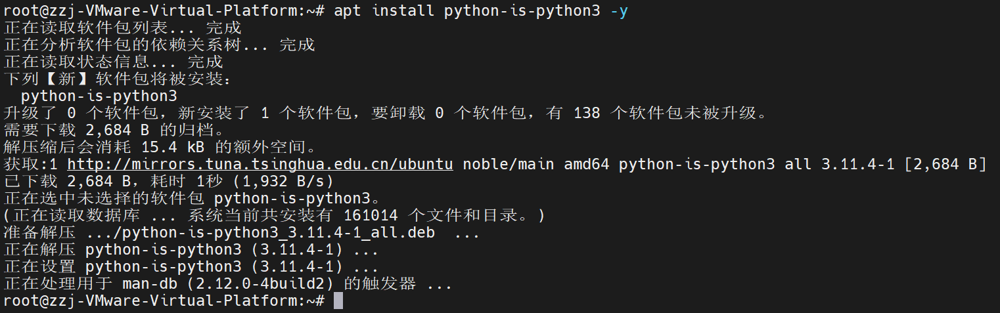
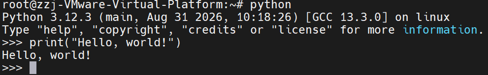

# Python

系统：CentOS Stream 10	8核4G

## 寻找版本

要安装python？打开python官网，发现没有Linux版本

根据CentOS Stream 10 的发行说明，现在有Python3.12的版本



```shell
python
```


好的，到此为止

那来看看我的另一台设备

Ubuntu24	8核4G



这下就不行了

但提示有Python的软件包

```shell
apt search python-is-python3
```



还真有3.11

## 安装Python

那就装

```shell
apt install python-is-python3 -y
```



## 验证

```shell
python
```



就这么简单