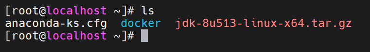
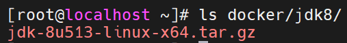
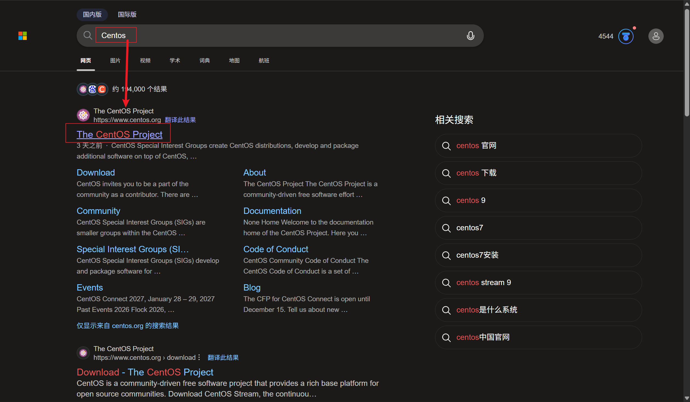
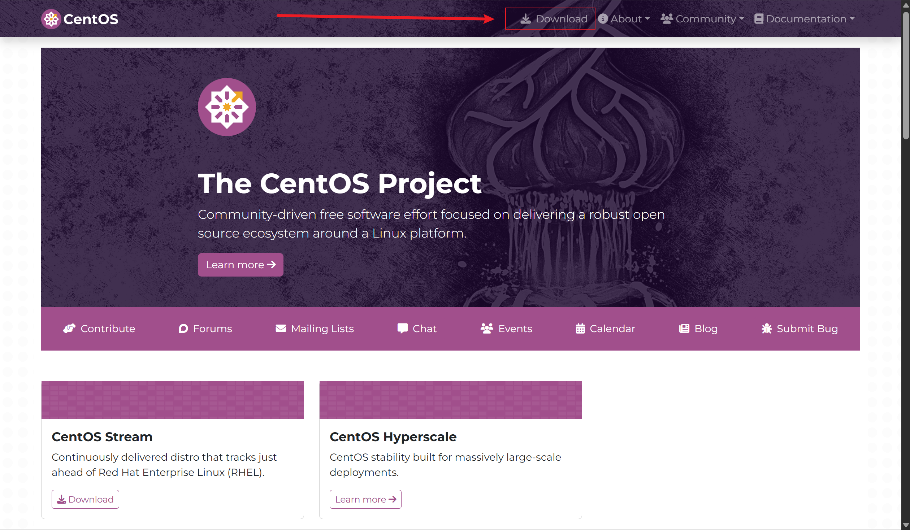
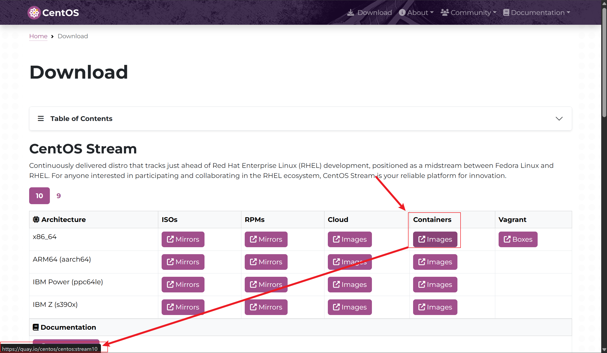
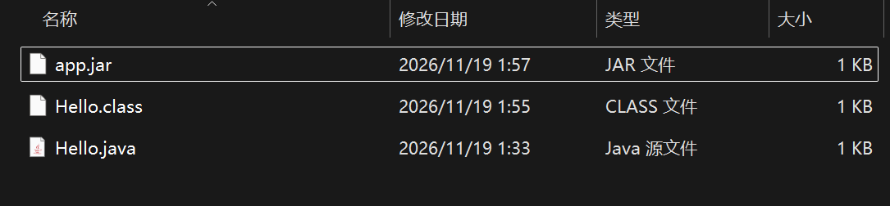
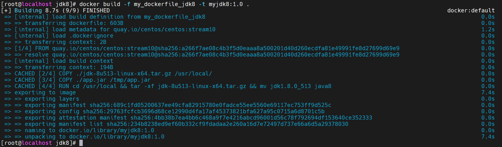
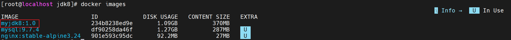

# Dockerfile自定义镜像

创建一个自己的docker镜像

以下演示创建java8的环境镜像

## 准备文件

已准备好jdk8，先放到相关目录



```shell
mkdir -p ~/docker/jdk8
cd ~/docker/jdk8
mv ~/jdk-8u513-linux-x64.tar.gz ~/docker/jdk8
```



## 创建Dockerfile

首先声明镜像容器里的系统版本，以本机的CentOS Stream 10为例

### 寻找版本号

搜索CentOS



打开CentOS官网，找到系统下载页面



找到容器镜像



发现链接指向https://quay.io/centos/centos:stream10

其中`quay.io/centos/centos:stream10`就是from后面的版本号了

写个java打jar包用来测试：

```java
public class Hello{
    public static void main(String[] args) {
        System.out.println("Hello, World!");
    }
}
```

```powershell
javac Hello.java
jar cfe app.jar Hello Hello.class
```

获得“app.jar”



那么开始写Dockerfile

```shell
vim my_dockerfile_jdk8
```

在里面写入以下内容：

```dockerfile
# 指定基础镜像
FROM quay.io/centos/centos:stream10
# 配置环境变量，JDK的安装目录、容器内时区
ENV JAVA_DIR=/usr/local
# 拷贝jdk和java项目的包
COPY ./jdk-8u513-linux-x64.tar.gz $JAVA_DIR/
COPY ./app.jar /tmp/app.jar
# 安装JDK
RUN cd $JAVA_DIR && tar -xf jdk-8u513-linux-x64.tar.gz && mv jdk1.8.0_513 java8
# 配置环境变量
ENV JAVA_HOME=$JAVA_DIR/java8
ENV PATH=$PATH:$JAVA_HOME/bin
# 入口，java项目的启动命令
ENTRYPOINT ["java", "-jar", "/tmp/app.jar"]
```

## 构建镜像

构建容器镜像myjdk8:1.0

```shell
docker build --file my_dockerfile_jdk8 --tag myjdk8:1.0 .
docker build -f my_dockerfile_jdk8 -t myjdk8:1.0 .
```



```shell
docker images
```



构建成功

## 验证

运行容器


