# Docker部署系统

以下将使用docker部署一个mysql+redis+java+vue的系统，前端用nginx

## 查阅文档

打开docker官网，好家伙，docker官网页面又变了

打开docs文档


打开Application development 应用开发


打开docker compose

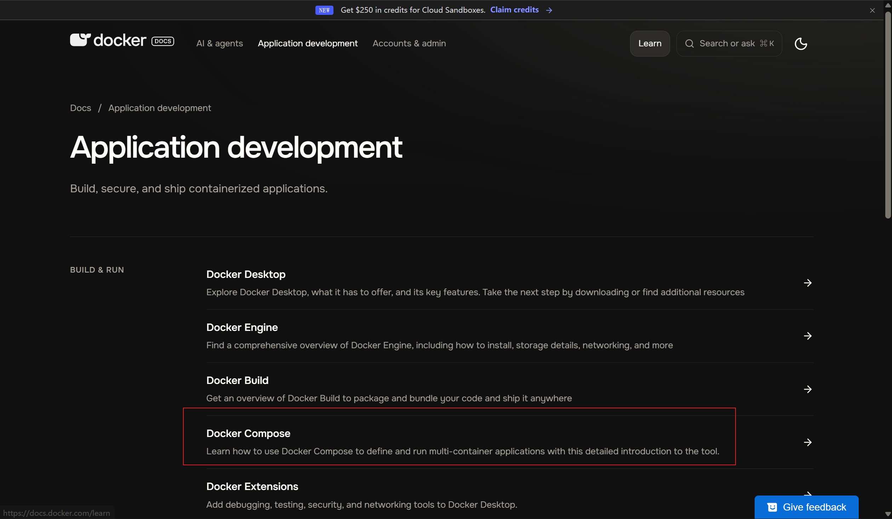

打开 Explore the Compose file reference 查阅compose文件参考


里面就是compose的参考文档

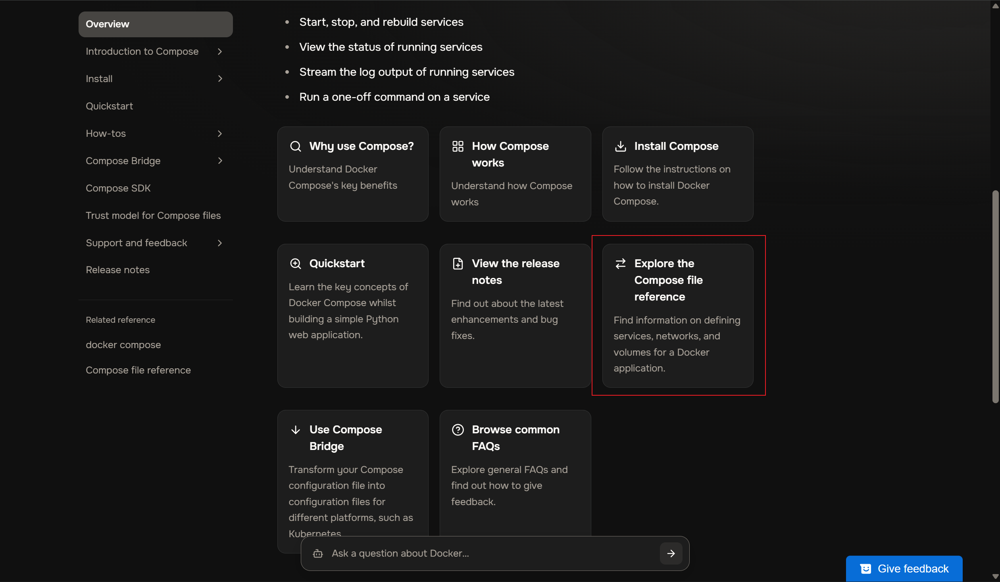

## 编写yaml

创建一个compose.yaml文件

查看文档得知，yaml共有6个顶级元素，分别是：

版本和名称、服务、网络、卷、配置、加密

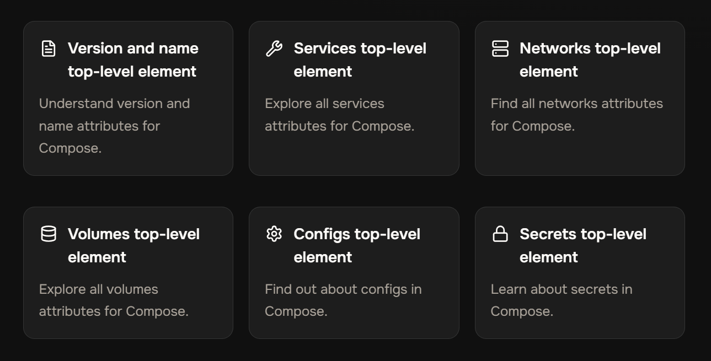

### 版本和名称

先看看版本和名称

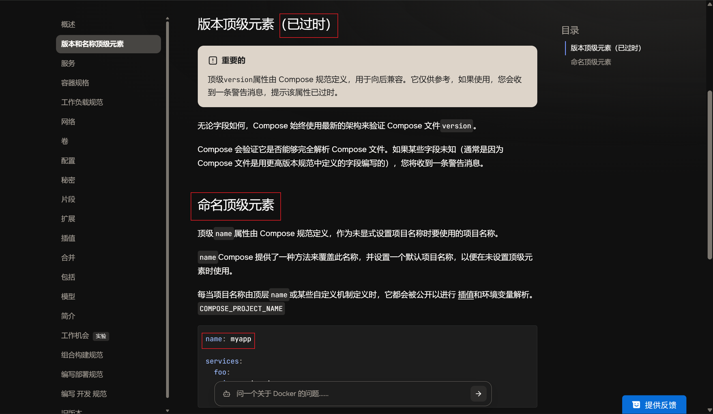

版本顶级元素已经过时，不用写了，写name就行

很简单，就一行

```yaml
name: myapp
```

### 服务

服务里就是将要安装的容器，这里应该有mysql、redis、jdk、nginx四个

正好文档给的示例也是nginx


结构大概是：

```yaml
services:
  [服务名]:
    image: 		#镜像名
    ports: 		#端口
    ...
```

#### Mysql

先写mysql吧

容器的相关参数不会？

请看左侧栏Container specification 容器规格

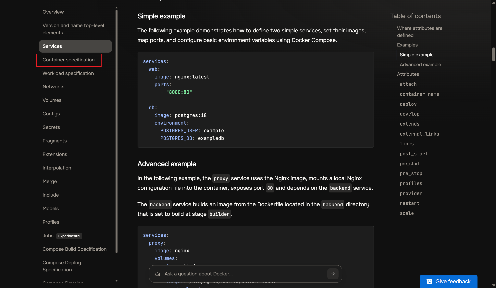

打开后右侧栏就是容器内相关参数的写法，点开image示例

正好还有个redis

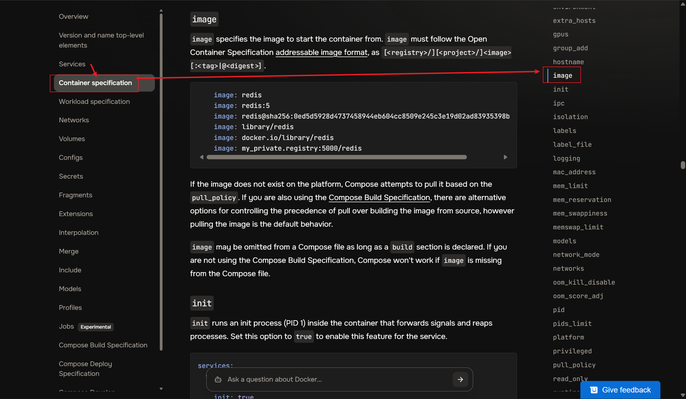

相关参数再参照mysql镜像文档：https://hub.docker.com/_/mysql

容器的启动根据我以前的文档：https://github.com/zzj081308/linux/blob/main/Docker%2BMysql/Docker%2BMySQL.md

```shell
docker run -d --name mysql-test -e MYSQL_ROOT_PASSWORD=123456 -p 3306:3306 mysql:9.7.2
```

稍作修改，然后写下以下配置

```yaml
name: myapp

services:
  mysql:
    container_name: mysql
    image: mysql:9.7.4
    environment:
      - MYSQL_ROOT_PASSWORD=123456
    ports:
      - 3306:3306
    volumes:
      - mysql-data:/var/lib/mysql
    networks:
      - myapp-network
volumes:
  mysql-data:
```

那么如何给容器里的数据库进行数据预加载，也就是初始化呢？手动exec进去直接初始化sql文件吗？那就不够“compose”了

如果想初始化容器里的数据库就需要做卷映射`-v [初始化sql文件目录]:/docker-entrypoint-initdb.d/[初始化sql文件名]:ro,z`

ro表示只读，防止被修改

z表示让SELinux 重新打标签，不加对于带SELinux的容器读不到，会报错

```shell
docker run -d --name mysql-test \
-e MYSQL_ROOT_PASSWORD=123456 \
-p 3306:3306 \
-v /root/init.sql:/docker-entrypoint-initdb.d/init.sql:ro,z \
mysql:9.7.4
```

此处我特地加个mysql容器验证


初始化文件是简单建了个demo_db的库

打开docker-entrypoint-initdb.d文件夹可见init.sql,且已执行


所以最终yaml的mysql部分如下：

```yaml
name: myapp

services:
  mysql:
    container_name: mysql
    image: mysql:9.7.4
    environment:
      - MYSQL_ROOT_PASSWORD=123456
    ports:
      - 3306:3306
    volumes:
      - mysql-data:/var/lib/mysql
      - /root/system_zzj/sql/init.sql:/docker-entrypoint-initdb.d/init.sql:ro,z
    networks:
      - myapp-network
volumes:
  mysql-data:
```

#### Java

查看pom配置文件得知

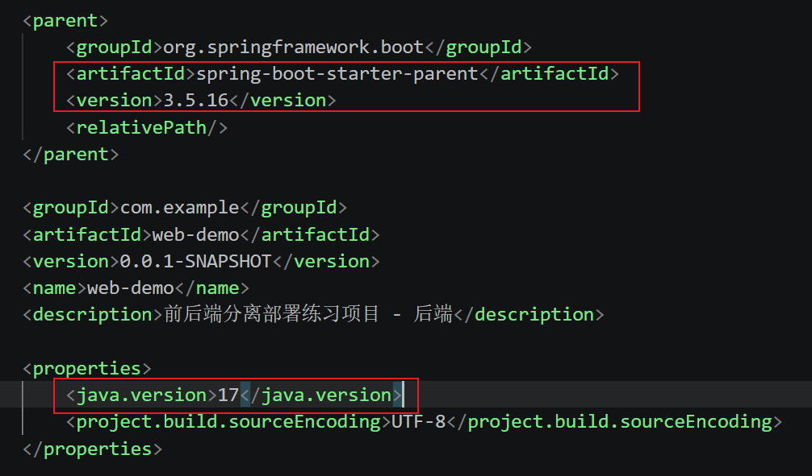

这个项目后端是spring boot 3.5.16和java17

至于openjdk，打开镜像时发现了这个

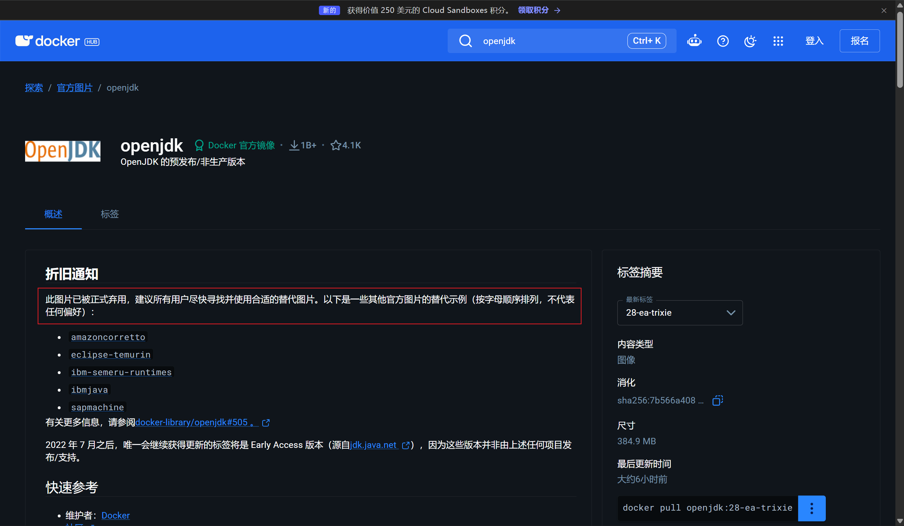

这个镜像已经过时被弃用了

现在好像都用eclipse-temurin

也就是这个：https://hub.docker.com/_/eclipse-temurin

里面现在最新的是eclipse-temurin:21.0.13.1_2-jre-noble

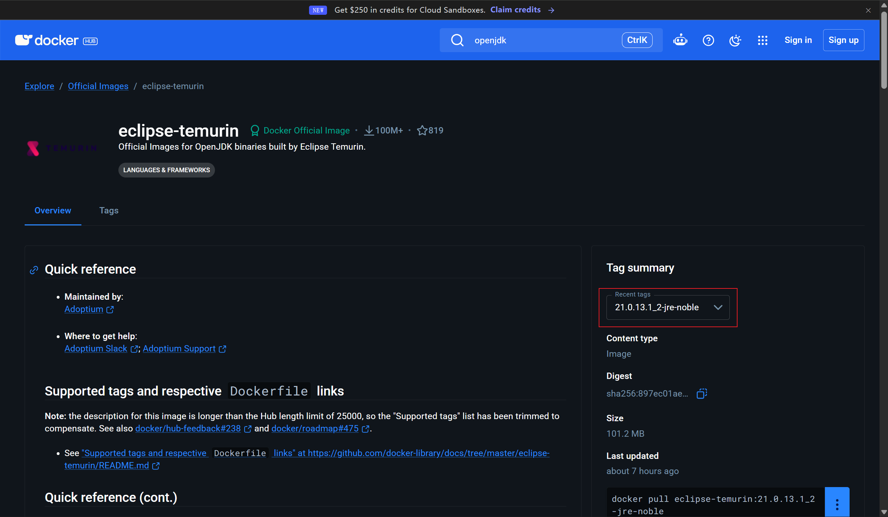

里面可以运行java21，向下兼容可行

##### 编写Dockerfile

写个Dockerfile来配置

```dockerfile
FROM eclipse-temurin:21.0.13.1_2-jre-noble
#创建并进入工作目录/app
WORKDIR /app	
COPY target/web-demo.jar app.jar
ENTRYPOINT ["java", "-jar", "/app/app.jar"]
```

在copy时jar包写的是相对路径target/web-demo.jar，所以Dockerfile需要放到backend下

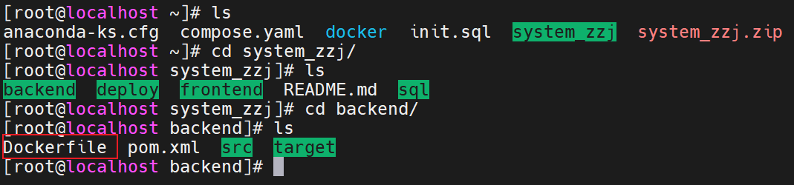

然后在compose里需要引用Dockerfile

参考官方compose文档的Workload specification 工作负载规范

里面有关于docker build的compose写法

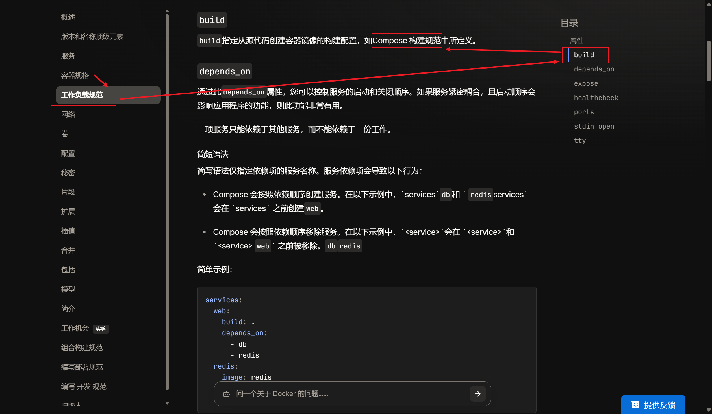

里面有两个基本参数

先是使用context告知Dockerfile的目录

然后用dockerfile指定Dockerfile文件

此时我的compose文件放在整个项目的外边

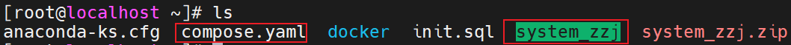

然后补上端口，网络，还有和数据库对接的环境变量

环境变量请参考项目内yml：system_zzj/backend/src/main/resources/application.yml

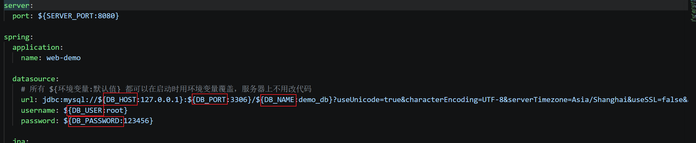

一共五个参数

注意，DB_HOST一定要用mysql容器名，因为mysql在另一个容器，127.0.0.1发现不了

DB_USER登陆用户不可选root，因为没开放root远程登陆，请使用init.sql建的用户demo_user登录

还可以加个image指定构建出来的镜像名

最终java的yaml如下

```yaml
name: myapp

services:
  mysql:
    container_name: mysql
    image: mysql:9.7.4
    environment:
      - MYSQL_ROOT_PASSWORD=123456
    ports:
      - 3306:3306
    volumes:
      - mysql-data:/var/lib/mysql
      - /root/system_zzj/sql/init.sql:/docker-entrypoint-initdb.d/init.sql:ro,z
    networks:
      - myapp-network
  
  java:
    container_name: java
    build:
      context: ./system_zzj/backend
      dockerfile: Dockerfile
    ports:
      - 8080:8080
    networks:
      - myapp-network
    environment:
      - DB_HOST=mysql
      - DB_PORT=3306
      - DB_NAME=demo_db
      - DB_USER=demo_user
      - DB_PASSWORD=Demo@123456
    image: zzj_backend:1.0

volumes:
  mysql-data: 

networks:
  myapp-network:
```

#### Nginx

寻找nginx镜像，找到最新为nginx:stable-alpine3.24

先简单写一下镜像名端口网络，没有环境变量

```yaml
name: myapp

services:
  mysql:
    container_name: mysql
    image: mysql:9.7.4
    environment:
      - MYSQL_ROOT_PASSWORD=123456
    ports:
      - 3306:3306
    volumes:
      - mysql-data:/var/lib/mysql
      - /root/system_zzj/sql/init.sql:/docker-entrypoint-initdb.d/init.sql:ro,z
    networks:
      - myapp-network
  
  java:
    container_name: java
    build:
      context: ./system_zzj/backend
      dockerfile: Dockerfile
    ports:
      - 8080:8080
    networks:
      - myapp-network
    environment:
      - DB_HOST=mysql
      - DB_PORT=3306
      - DB_NAME=demo_db
      - DB_USER=demo_user
      - DB_PASSWORD=Demo@123456
    image: zzj_backend:1.0

  nginx:
    container_name: nginx
    image: nginx:stable-alpine3.24
    ports:
      - 80:80
    networks:
      - myapp-network

volumes:
  mysql-data: 

networks:
  myapp-network:
```

然后配置文件和资源文件用卷挂载

那么问题来了，怎么知道nginx配置文件和资源文件的路径呢？

##### 确认挂载路径

/etc/nginx/conf.d/default.conf和/usr/share/nginx/html吗，万一版本不一样变了呢？

先查看官方文档https://hub.docker.com/_/nginx

里面可以看到

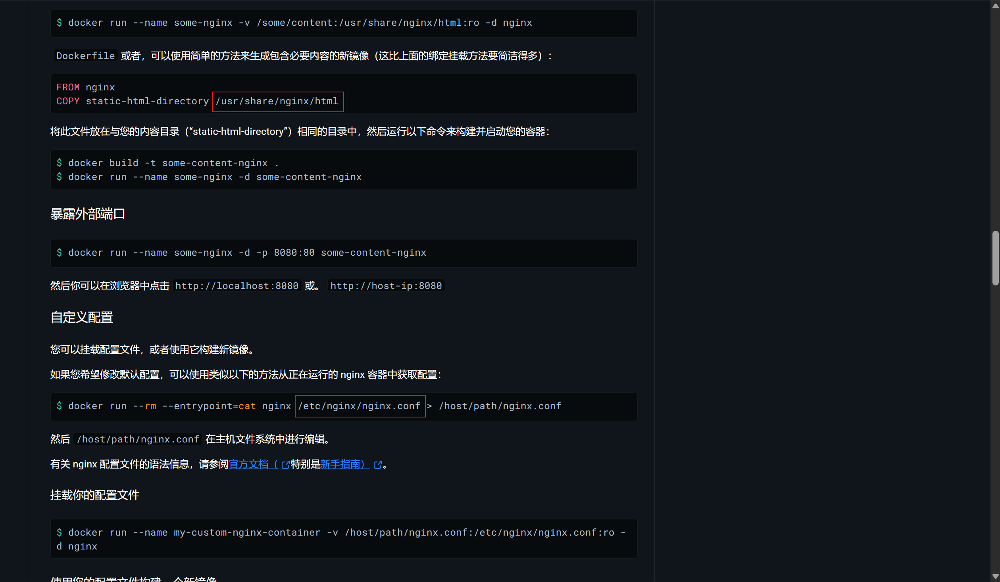

资源文件写在`/usr/share/nginx/html`

配置文件写在`/etc/nginx/nginx.conf`

实在不放心那就去运行个容器看看究竟！

```shell
docker run -d --name nginx_test -p 80:80 nginx:stable-alpine3.24
```

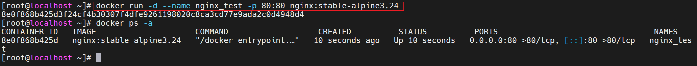

可以看到nginx容器起来了，访问服务器80端口

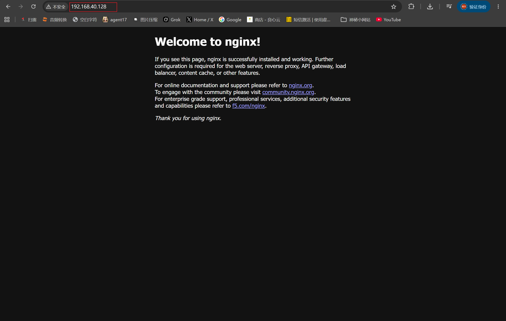

也可以访问，那就进容器查看

```shell
docker exec -it nginx_test sh
ls /usr/share/nginx/html/
cat /usr/share/nginx/html/index.html
```

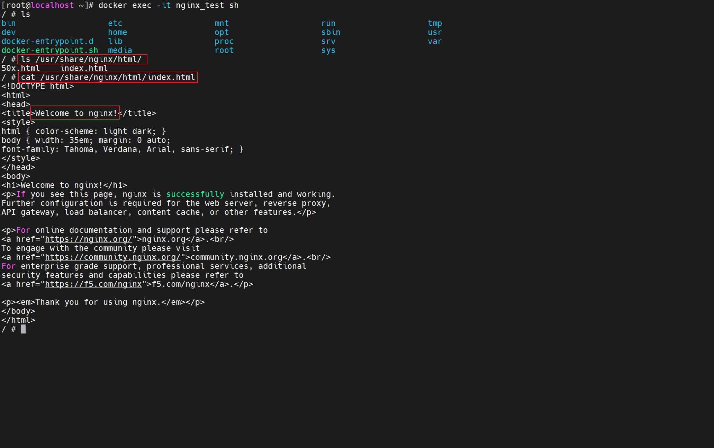

可以看到资源文件

再看看配置文件

```shell
ls /etc/nginx
cat /etc/nginx/nginx.conf
```

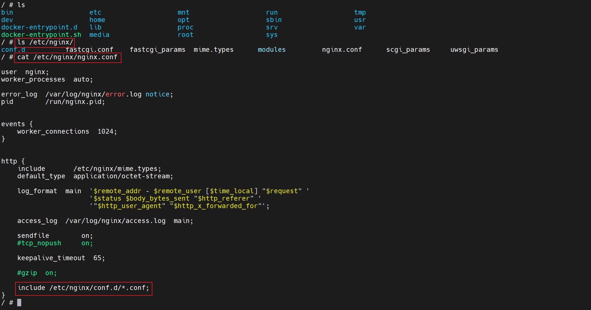

可以看到这里的nginx也是分段写的，server也在`etc/nginx/conf.d/`

```shell
ls etc/nginx/conf.d/
cat etc/nginx/conf.d/default.conf
```

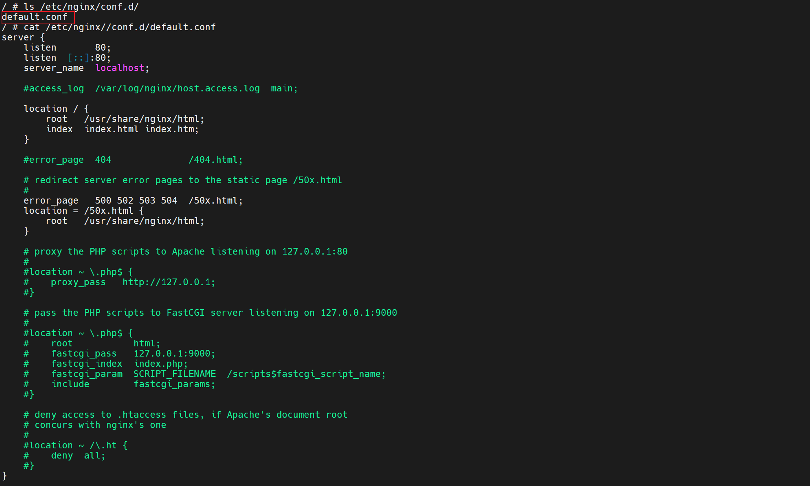

好了，看也也一样是`etc/nginx/conf.d/default.conf`

##### 编写配置文件

编写一下nginx配置文件（原本system_zzj是ai写的，nginx配置文件已经写好放在system_zzj\deploy了，但还是再写一次吧）

```nginx
server {
    listen 80;
    server_name 192.168.40.128;
    
    root /usr/share/nginx/html/;
    index index.html;

    location / {
        try_files $uri $uri/ /index.html;
    }

    location /api/ {
        proxy_pass http://java:8080;
        proxy_set_header Host $host;
        proxy_set_header X-Real-IP $remote_addr;
    }
}

```

写入yaml

```yaml
name: myapp

services:
  mysql:
    container_name: mysql
    image: mysql:9.7.4
    environment:
      - MYSQL_ROOT_PASSWORD=123456
    ports:
      - 3306:3306
    volumes:
      - mysql-data:/var/lib/mysql
      - /root/system_zzj/sql/init.sql:/docker-entrypoint-initdb.d/init.sql:ro,z
    networks:
      - myapp-network
  
  java:
    container_name: java
    build:
      context: ./system_zzj/backend
      dockerfile: Dockerfile
    ports:
      - 8080:8080
    networks:
      - myapp-network
    environment:
      - DB_HOST=mysql
      - DB_PORT=3306
      - DB_NAME=demo_db
      - DB_USER=demo_user
      - DB_PASSWORD=Demo@123456
    image: zzj_backend:1.0

  nginx:
    container_name: nginx
    image: nginx:stable-alpine3.24
    ports:
      - 80:80
    networks:
      - myapp-network
    volumes:
      - ./system_zzj/frontend/dist:/usr/share/nginx/html:ro
      - ./system_zzj/deploy/nginx.conf:/etc/nginx/conf.d/default.conf:ro

volumes:
  mysql-data: 

networks:
  myapp-network:
```

## 初次验证

现在前后端数据库都有了，试试运行，冲！！！

```shell
docker compose up -d
docker ps -a
```

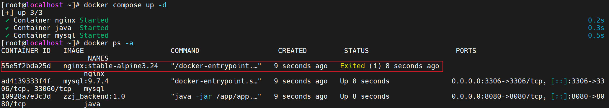

我去，nginx坠机了

看看日志

```shell
docker logs nginx
```

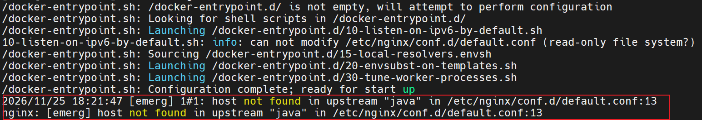

看来是java没找到，因为nginx比java启动更快，compose里虽然java先写但不保证顺序

所以要加上一个参数声明依赖关系：nginx依赖java依赖mysql

其实java也有可能报错，因为java会连接mysql，但java启动实在太慢，比mysql慢了所以不报错，纯狗运

加上依赖参数depends_on

```yaml
name: myapp

services:
  mysql:
    container_name: mysql
    image: mysql:9.7.4
    environment:
      - MYSQL_ROOT_PASSWORD=123456
    ports:
      - 3306:3306
    volumes:
      - mysql-data:/var/lib/mysql
      - /root/system_zzj/sql/init.sql:/docker-entrypoint-initdb.d/init.sql:ro,z
    networks:
      - myapp-network
  
  java:
    container_name: java
    build:
      context: ./system_zzj/backend
      dockerfile: Dockerfile
    ports:
      - 8080:8080
    networks:
      - myapp-network
    environment:
      - DB_HOST=mysql
      - DB_PORT=3306
      - DB_NAME=demo_db
      - DB_USER=demo_user
      - DB_PASSWORD=Demo@123456
    image: zzj_backend:1.0
    depends_on:
      - mysql

  nginx:
    container_name: nginx
    image: nginx:stable-alpine3.24
    ports:
      - 80:80
    networks:
      - myapp-network
    volumes:
      - ./system_zzj/frontend/dist:/usr/share/nginx/html:ro
      - ./system_zzj/deploy/nginx.conf:/etc/nginx/conf.d/default.conf:ro
    depends_on:
      - java

volumes:
  mysql-data: 

networks:
  myapp-network:
```

再运行

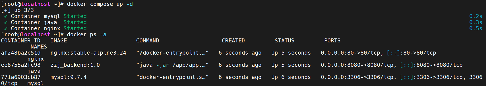

这下就好了

然后访问网页

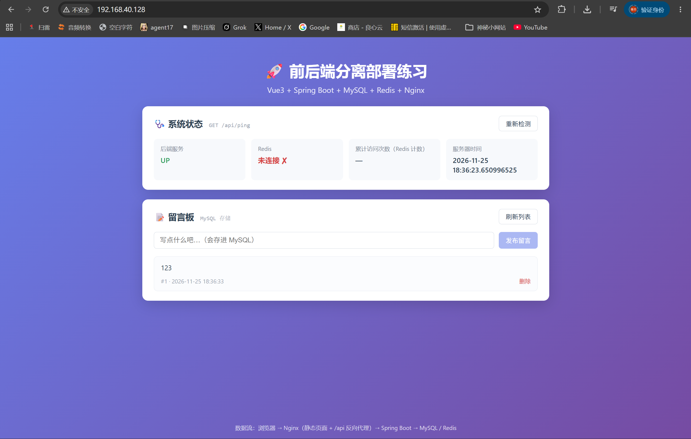

很好，留言板也能用，看来mysql也没问题

还差redis了，但其实这种小系统用redis完全没必要哈哈

## 补充redis

redis配置已经写在后端了，根据后端的配置写环境变量

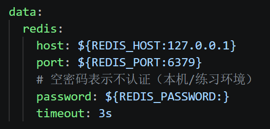

三个变量：REDIS_HOST、REDIS_PORT、REDIS_PASSWORD，密码暂时不用

这里是写在java内

```yaml
name: myapp

services:
  mysql:
    container_name: mysql
    image: mysql:9.7.4
    environment:
      - MYSQL_ROOT_PASSWORD=123456
    ports:
      - 3306:3306
    volumes:
      - mysql-data:/var/lib/mysql
      - /root/system_zzj/sql/init.sql:/docker-entrypoint-initdb.d/init.sql:ro,z
    networks:
      - myapp-network
  
  java:
    container_name: java
    build:
      context: ./system_zzj/backend
      dockerfile: Dockerfile
    ports:
      - 8080:8080
    networks:
      - myapp-network
    environment:
      - DB_HOST=mysql
      - DB_PORT=3306
      - DB_NAME=demo_db
      - DB_USER=demo_user
      - DB_PASSWORD=Demo@123456
      - REDIS_HOST=redis
      - REDIS_PORT=6379
    image: zzj_backend:1.0
    depends_on:
      - mysql

  nginx:
    container_name: nginx
    image: nginx:stable-alpine3.24
    ports:
      - 80:80
    networks:
      - myapp-network
    volumes:
      - ./system_zzj/frontend/dist:/usr/share/nginx/html:ro
      - ./system_zzj/deploy/nginx.conf:/etc/nginx/conf.d/default.conf:ro
    depends_on:
      - java

volumes:
  mysql-data: 

networks:
  myapp-network:
```

redis服务里只需要简单写个镜像和网络，然后java也需要依赖redis

```yaml
name: myapp

services:
  mysql:
    container_name: mysql
    image: mysql:9.7.4
    environment:
      - MYSQL_ROOT_PASSWORD=123456
    ports:
      - 3306:3306
    volumes:
      - mysql-data:/var/lib/mysql
      - /root/system_zzj/sql/init.sql:/docker-entrypoint-initdb.d/init.sql:ro,z
    networks:
      - myapp-network
  
  java:
    container_name: java
    build:
      context: ./system_zzj/backend
      dockerfile: Dockerfile
    ports:
      - 8080:8080
    networks:
      - myapp-network
    environment:
      - DB_HOST=mysql
      - DB_PORT=3306
      - DB_NAME=demo_db
      - DB_USER=demo_user
      - DB_PASSWORD=Demo@123456
      - REDIS_HOST=redis
      - REDIS_PORT=6379
    image: zzj_backend:1.0
    depends_on:
      - mysql
      - redis

  nginx:
    container_name: nginx
    image: nginx:stable-alpine3.24
    ports:
      - 80:80
    networks:
      - myapp-network
    volumes:
      - ./system_zzj/frontend/dist:/usr/share/nginx/html:ro
      - ./system_zzj/deploy/nginx.conf:/etc/nginx/conf.d/default.conf:ro
    depends_on:
      - java
    
  redis:
    container_name: redis
    image: redis:latest
    networks:
      - myapp-network

volumes:
  mysql-data: 

networks:
  myapp-network:
```

配置完了就启动！

```shell
docker compose up -d
docker ps -a
```

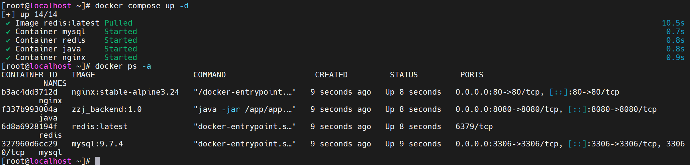

很好，容器都起来了

### 验证

访问服务器

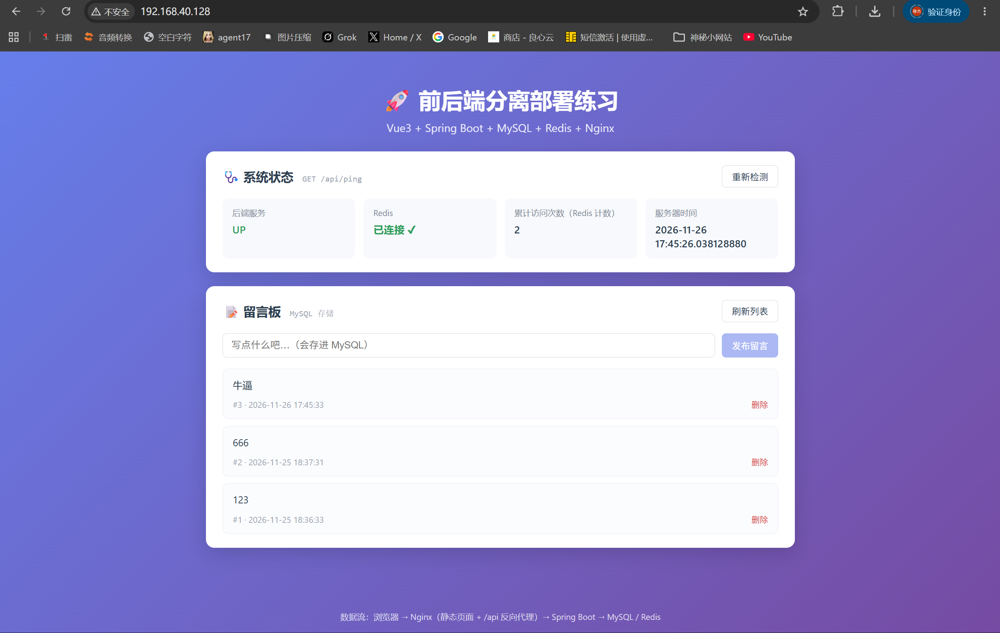

完美
